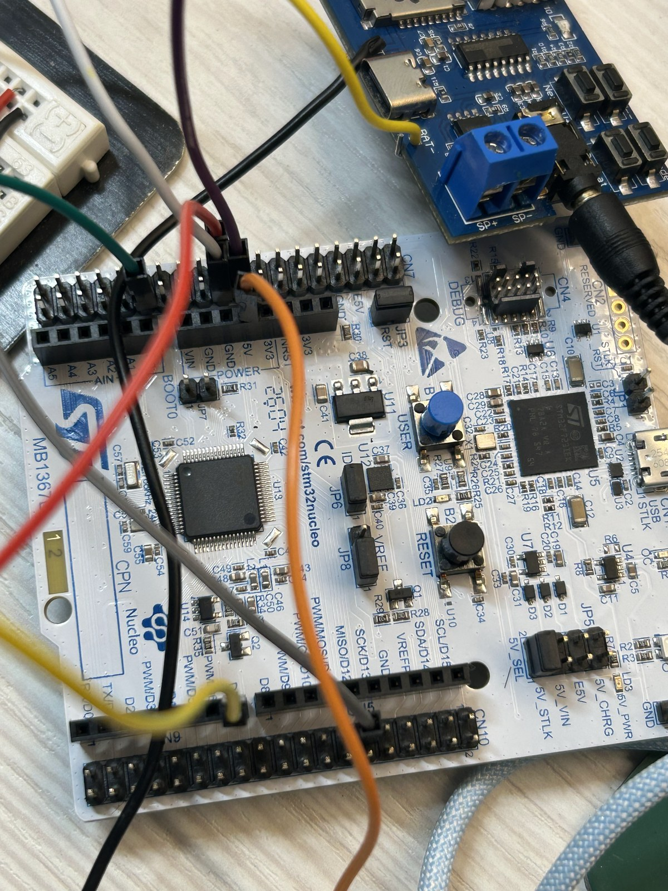
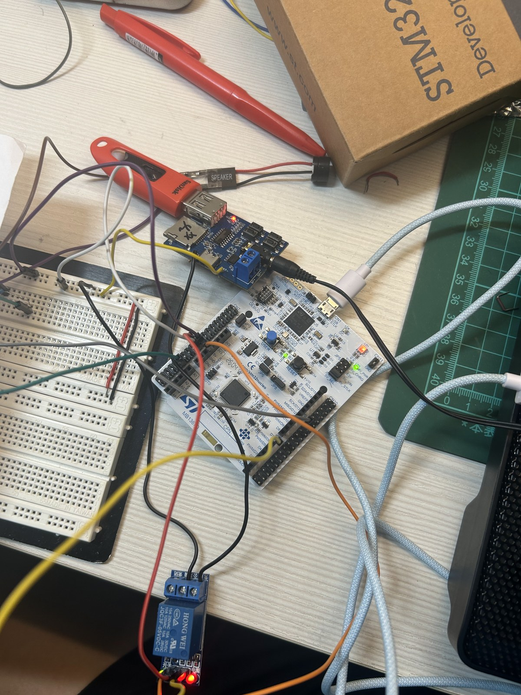
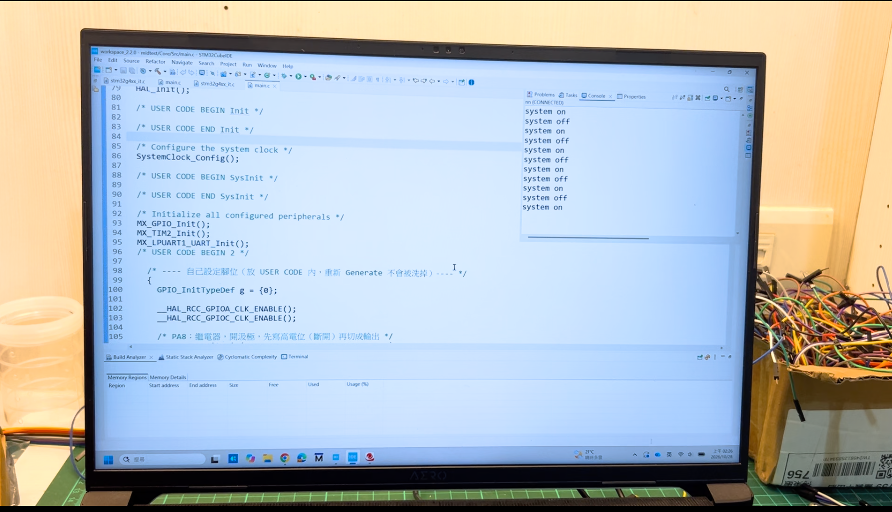

# 村里廣播前置提示音與電源控制系統（NUCLEO-G474RE 期中專題）

按一下按鈕，廣播前先播放提示音樂並亮燈、嗶一聲；再按一下就關閉。每次切換都會在電腦終端機留下一行紀錄。

## 1. 情境故事

- **誰**：村裡的里長小明
- **在哪**：村里辦公處的廣播系統
- **遇到什麼麻煩**：村民常常忽略廣播，聽到時已經漏掉前面的內容
- **裝置怎麼幫忙**：廣播前先放一段音樂（像垃圾車音樂一樣讓人有印象），提醒大家「要廣播了」。里長只要按一個按鈕就能開關，旁邊的燈號顯示目前狀態，電腦上也會記錄每次開關。

## 2. 替身對照

| 故事裡的角色 | 板上／外接替身 | 腳位／外設 |
|---|---|---|
| 里長開關廣播按鈕 | 板載藍色按鈕 B1 | PC13（GPIO 輸入，輪詢） |
| 廣播系統開關狀態 | 板載綠燈 LD2 | PA5（GPIO 輸出） |
| 大喇叭預備警示聲 | 無源蜂鳴器 | PA0（TIM2_CH1 PWM） |
| 廣播擴大機／MP3 電源 | 5V 單路繼電器模組 | PA8 / D7（開汲極） |
| 前置音樂 | MP3 解碼板 GPD2856 | 經繼電器 NO 端供 5V |
| 村公所廣播紀錄 | 電腦序列埠終端機 | LPUART1（ST-LINK VCP） |

時間縮放：一次真實廣播（幾分鐘）→ Demo 中「按第 1 下到按第 2 下」之間；廣播前警示鈴 → 嗶一聲 80 ms。

## 3. 功能與驗收條件

| 操作動作 | 預期結果 | 實測結果 | 判定 |
|---|---|---|---|
| 上電／按 RESET | 繼電器不吸合、綠燈滅、蜂鳴器不響 | 開機不誤吸合，MP3 不出聲 | 過 |
| 按 B1 第 1 次 | 嗶一聲、綠燈亮、繼電器吸合、終端機印 `system on` | 符合預期，MP3 板通電播放 | 過 |
| 廣播進行中 | MP3 板持續獲得 5V 並播放 | 繼電器 NO 端導通，持續播放 | 過 |
| 按 B1 第 2 次 | 嗶一聲、綠燈滅、繼電器斷開、終端機印 `system off` | 符合預期，MP3 斷電停止 | 過 |
| 按住 B1 不放 | 只在按下那一刻切換一次 | 只切換一次、只印一行、只嗶一聲 | 過 |

## 4. 用到的技術（第 3～7 週勾選表）

**GPIO**
- [x] **GPIO 輸出**：綠燈 LD2 與繼電器開關｜PA5 推挽、PA8 開汲極｜MODER = 01、OTYPER（PA8 = 1）｜BSRR 設／清
- [x] **GPIO 輸入**：里長按鈕 B1，主迴圈輪詢｜PC13｜MODER = 00、PUPDR = 00｜讀 IDR
- [x] **複用功能 AF**：終端機串列埠與蜂鳴器 PWM｜PA2 / PA3：MODER = 10、AF12（LPUART1）｜PA0：AF1（TIM2_CH1）

**時脈**
- [x] **PLL 170 MHz**：系統、TIM2 與 LPUART1 鮑率的共同基準｜HSI16 ÷ 4 × 85 ÷ 2｜FLASH 4 等待週期 + boost

**中斷**
- [ ] 外部中斷 EXTI
- [ ] NVIC 致能
- [ ] 優先權與巢狀
- [x] **軟體去彈跳**：按一下只切換一次｜電位改變 → `HAL_Delay(30)` 再讀一次，仍不同才算｜主迴圈每 5 ms 讀一次

**UART**
- [x] **UART 傳送**：每次切換印出 `system on` / `system off`｜LPUART1 115200 8N1｜BRR ≈ 377778｜`HAL_UART_Transmit` 輪詢 TXE
- [ ] UART 接收 + 環形緩衝

**Timer / PWM**
- [ ] Timer 定時中斷
- [x] **PWM**：無源蜂鳴器 2.7 kHz 提示音，每次切換嗶一聲 80 ms｜TIM2_CH1（PA0）｜PSC = 169、ARR = 369｜CCR1 = 185（50%），0 = 靜音
- [ ] 輸入捕捉

共 13 項：用到 7 項、沒用到 6 項。

## 5. 腳位表

| 腳位 | 功能 | 接到 | 說明 |
|---|---|---|---|
| PA0 | TIM2_CH1（PWM，AF1） | 無源蜂鳴器 (+) | 串聯 220Ω 限流電阻；2.7 kHz、50% 占空比 |
| PA8 (D7) | GPIO 輸出，開汲極 | 繼電器 IN | 低電位觸發：LOW = 吸合、放開 = 斷開；開機先放開，避免誤吸合 |
| PC13 | GPIO 輸入 | 板載藍色按鈕 B1 | 板上已有電阻，不開內部上下拉；軟體去彈跳 30 ms |
| PA5 | GPIO 輸出，推挽 | 板載綠燈 LD2 | HIGH = 亮（系統 ON）、LOW = 滅（系統 OFF） |
| PA2 / PA3 | LPUART1（AF12） | ST-LINK 虛擬 COM 埠 | 115200 8N1 |

注意：NUCLEO-G474RE 的 USB 虛擬 COM 埠接的是 **LPUART1**（PA2 / PA3），不是 USART2。

## 6. 建置與執行

1. **開發環境**：STM32CubeIDE，開發板 NUCLEO-G474RE
2. **匯入專案**：File → Import → Existing Projects into Workspace，選擇本 repo 的資料夾
3. **編譯**：按 Build（鐵鎚圖示），確認 0 errors
4. **燒錄**：USB 接上板子，按 Run
5. **開終端機**：Tera Term／PuTTY／CubeIDE Console 都可以
   - 連接埠：裝置管理員中的 **STMicroelectronics STLink Virtual COM Port (COMx)**
   - 設定：**115200 8N1**，無流量控制
6. **操作**：按藍色按鈕 B1，終端機會輪流印出：
   ```
   system on
   system off
   ```

## 7. 程式結構

所有程式都在 `Core/Src/main.c`，自己寫的部分都放在 `USER CODE` 區塊內，重新 Generate 不會被洗掉。

| 函式／區塊 | 做什麼 |
|---|---|
| `SystemClock_Config()` | HSI16 → PLL → 170 MHz 系統時脈 |
| `MX_GPIO_Init()` | PA8 開汲極（先寫高電位再設成輸出）、PA5 推挽、PC13 輸入 |
| `MX_LPUART1_UART_Init()` | LPUART1 115200 8N1 |
| `MX_TIM2_Init()` | TIM2 PWM：PSC = 169、ARR = 369 → 約 2.7 kHz |
| `USER CODE 2` | 啟動 PWM（先靜音）、系統設為 OFF、記住按鈕「沒按」時的電位 `btn_idle` |
| 主迴圈 `while(1)` | 每 5 ms 讀按鈕 → 去彈跳 → 偵測「剛按下」→ 切換狀態、嗶一聲、印出狀態；嗶滿 80 ms 自動靜音 |
| `SetMusic(on)` | 繼電器與綠燈一起切換 |
| `Beep()` | 設定 CCR1 開始響，記下開始時間（不卡住主迴圈） |
| `UART_Print(s)` | 透過 LPUART1 送出一串文字 |

本專案沒有使用任何中斷服務程式（ISR），全部在主迴圈輪詢完成；計時使用 `HAL_GetTick()`（1 ms）。

## 8. 實作照片


板子、USB 線、繼電器、蜂鳴器與 MP3 板全景


接線特寫：PA8 → 繼電器 IN、PA0 → 蜂鳴器


按第 1 次：綠燈亮，MP3 播放中


按第 2 次：綠燈滅，MP3 停止


終端機（115200 8N1）輪流印出 system on / system off

## 9. AI 使用說明

本專案開發過程有使用生成式 AI（Claude、Gemini）協助：

**AI 幫了哪段**
- 在主程式加入 LPUART1 輸出：`UART_Print()` 函式與印出 `system on` / `system off` 的判斷
- 排查重新產生程式碼後功能消失的原因（`MX_GPIO_Init` 被 CubeMX 改寫），改在 `USER CODE` 區塊內補上腳位設定
- 依實際程式整理投影片圖表與本 README 的章節架構

**我怎麼查核**
- 燒錄到 NUCLEO-G474RE 實測：按 B1 兩次，終端機（115200 8N1）依序印出 `system on` / `system off`，燈號、蜂鳴器、繼電器都正確動作
- 用 CubeMX 對照 TIM2：170 MHz ÷ (169 + 1) ÷ (369 + 1) ≈ 2.7 kHz；確認 LPUART1 在 PA2 / PA3
- 逐項比對勾選表與 `main.c`，沒用到的項目保留空框

## 10. 已知限制

- **MP3 只能整個開或關**：繼電器切的是 MP3 板的電源，沒辦法選曲、調音量或暫停；換成真貨要改用 MP3 板的 UART 指令控制
- **去彈跳會短暫卡住程式**：按鈕電位變化時用 `HAL_Delay(30)` 等待，這 30 ms 內主迴圈不做別的事；若之後功能變多，應改成用 `HAL_GetTick()` 計時的非阻塞寫法
- **UART 只會送、不會收**：目前無法從電腦下指令控制，之後可加入 UART 接收
- **替身與真實設備的差距**：蜂鳴器替代廣播大喇叭，真實廣播系統需要功率擴大機；5V 小型繼電器只適合低壓，若要切換 110V 擴大機電源，需要改用額定電壓足夠、有安全隔離的繼電器並由合格人員配線
